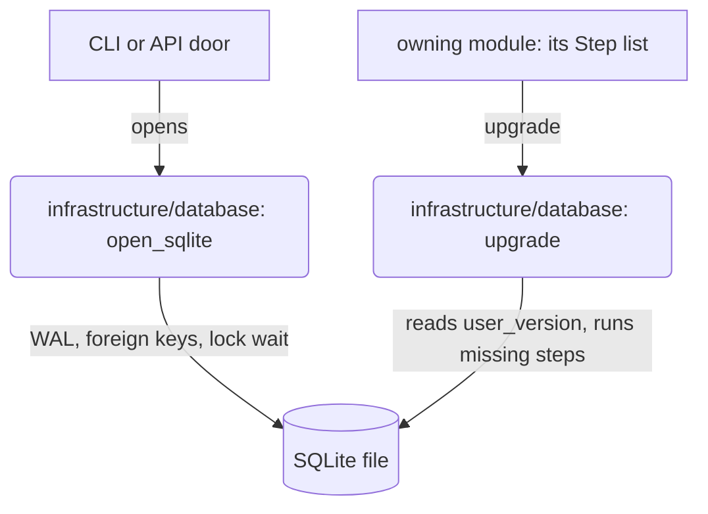

# Database Schema Versions

**What:** every SpecWeaver SQLite file carries its schema version in `PRAGMA user_version`, and the
module that owns the file keeps an ordered list of numbered steps (`TECH-090`).

**Why:** follows the Bounded Contexts architecture: a domain changes its schema without touching
another domain's models, and one place (`infrastructure/database/`) decides how a file is opened
and how steps run.

## How a file is brought up to date

| File | Owner of the steps |
|---|---|
| `~/.specweaver/specweaver.db` | `core/config/bootstrap/db_bootstrap.py` |
| `~/.specweaver/pipeline_state.db` | `core/flow/engine/store.py` |
| `<project>/.specweaver/graph.db` | `graph/core/store/repository.py` |
| `<project>/.specweaver/reservations.db` | `core/flow/engine/reservation.py` |

- Each step and its version change commit in one `BEGIN IMMEDIATE` transaction; the version is
  read again once the lock is held, so two processes never apply a step twice.
- A file newer than the code is refused, naming the file and both versions.
- A step that has shipped is never edited; a change is a new step at the end.
- How to add one: `docs/dev_guides/working_in_this_repo.md` trap 12.

Alembic was removed in `TECH-090`: nothing ever ran it, and its scripts could not run on any
current database.
