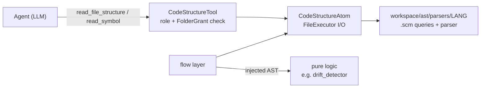

# D-SENS-02 — Polyglot AST Skeleton Extractor & Context Ledger

**Status**: Built; `🔧` until the user signs off. · **Feature ID**: 3.22 · **Phase**: 3

| | |
|---|---|
| Lives in | `workspace/ast/parsers/` · `CodeStructureAtom` · `CodeStructureTool` (`sandbox/code_structure/`) |
| Used by | Reviewer and Implementer agents; `flow` handlers that inject ASTs into pure logic (e.g. `drift_detector`) |
| Replaces | the "Context Ledger" `[304 Not Modified]` idea (see below) |

## What it does

Cuts context-window bloat and cost in long agent sessions. A reviewing model is offered
`read_file_structure` (imports, signatures, docstrings), `read_symbol` (one class or function in
full), `read_symbol_body` (its inner block only), `list_symbols` (filterable by visibility) and
`read_unrolled_symbol` (`B-INTL-02`). Parsing is `tree-sitter` with a `.scm` query per language in
`workspace/ast/parsers/`, run by `CodeStructureAtom`.

The write intents — `replace_symbol`, `replace_symbol_body`, `add_symbol`, `delete_symbol` — are
built for the implementer role, which no run gives a model yet `[agreed 2026-10-12]`.

## Why not a 304 Context Ledger

The first idea: a SQLite-backed "Context Ledger" tracks what the agent has read in a session and
answers a repeat read with `[304 Not Modified]` to save tokens.

Discarded, because LLMs lose attention to content deep in a long context ("Lost in the Middle"): a
file loaded 20 turns ago is effectively forgotten. A reread refreshes attention. Blocking it forces
the agent onto fading memory and causes hallucinated syntax in generated code. A skeleton refreshes
attention with just the interface, at a fraction of the tokens.

## Architecture

- **Parsers:** `workspace/ast/parsers/<lang>/`; test runners in `sandbox/language/core/<lang>/`.
- **Dependency injection:** pure-logic layers (e.g. `drift_detector`) never run tree-sitter. The
  flow layer runs `CodeStructureAtom` and passes them the result.

## Decisions

| # | Decision | Rationale | Architectural Switch? |
|---|----------|-----------|----------------------|
| AD-1 | Dedicated CodeStructureTool | Keeps raw filesystem operations and code investigation apart in the LLM's tool choice. | No |
| AD-2 | Deprecate `[304 Not Modified]` | Resolves "Lost in the Middle" context bloat via skeleton structure instead of caching. | No |
| AD-3 | Parsers are injected | tree-sitter runs only in the flow layer and atoms; pure logic gets the result as data, as `tach` requires. | No |

## Functional Requirements

| # | FR | Actor | Action | Outcome |
|---|-----|-------|--------|---------|
| FR-1 | Skeleton Abstraction | CodeStructureTool | reads a file structure | The system SHALL detect the language, route to the correct parser, execute the Tree-Sitter tags query, and return ONLY the file's imports, class/method signatures, and docstrings. |
| FR-2 | Symbol Extraction | CodeStructureTool | reads a specific symbol | The system SHALL return the entire implementation payload of exclusively the requested symbol (class/function) from the target file. |
| FR-3 | Polyglot Registry | Flow Engine | routes a file to its parser | The system SHALL pick a file's parser by its ending through one factory (`workspace/ast/parsers/factory.py`): Python, Java, Kotlin, TypeScript, Rust, Go, C, C++, SQL, Markdown. |
| FR-4 | Query Fallback | CodeStructureTool | encounters unsupported language | If the file's language has no registered extractor plugin, the system SHALL throw an explicit error reminding the LLM to use `read_file` instead. |
| FR-5 | Symbol Replacement | CodeStructureTool | writes into a specific symbol | The system SHALL replace, add or delete a symbol by its AST node, never by regex or byte matching; offered to the implementer role only, which no run gives a model yet `[agreed 2026-10-12]`. |
| FR-6 | Symbol Listing | CodeStructureTool | lists available symbols | The system SHALL return a flat array mapping of all targetable symbols within a file, filterable by a designated visibility constraint (e.g. `['public']`). |
| FR-7 | Symbol Body Extraction | CodeStructureTool | reads only the inner block | The system SHALL return only the internal execution logic block (`{...}`) of a symbol without extracting its decorators or external class wrappers. |

## Non-Functional Requirements

| # | NFR | Threshold / Constraint |
|---|-----|----------------------|
| NFR-1 | Latency | AST Extraction must occur locally via `tree-sitter` with a P95 latency of `<50ms` per file to prevent agent blocking. |
| NFR-2 | Reliability | The Tree-sitter abstraction MUST NOT fail the pipeline if a file contains minor syntax errors (Tree-sitter error-recovery must remain enabled). |

## External dependencies

| Tool | Version | Key API Surface | Source |
|------|---------|----------------|--------|
| `tree-sitter` | Latest | `Parser`, `Language`, `.scm` queries | Already in `pyproject.toml` |
| `tree-sitter-<lang>` | Latest | Pre-compiled language grammars | Already in `pyproject.toml` |

## Live demo

`ToolDispatcher.create_standard_set(..., role="reviewer", allowed_tools=["ast"])` over a project
with `src/calc.py` and `src/Hello.java`: the skeleton of `calc.py` keeps signatures and docstrings
and no body text; `read_symbol area` and `read_symbol_body Calc.add` return exactly that symbol and
that block; `list_symbols` with `visibility: [public]` drops `_secret` and Java's `private hidden`;
a file with a syntax error still gives a skeleton; `notes.xyz` says to use `read_file`; `../` is
refused; each call takes about 2 ms.
`tests/integration/sandbox/test_code_structure_tools_for_a_reviewer.py` does exactly this.

## Sub-features

| SF | Does | FRs | Plan |
|----|------|-----|------|
| SF-01 | Read side: parsers, `CodeStructureAtom`, the read intents | FR-1, FR-2, FR-3, FR-4, FR-6, FR-7 | [sf01](D-SENS-02_sf01_implementation_plan.md) |
| SF-02 | Write side: replace, add, delete a symbol | FR-5 | [sf02](D-SENS-02_sf02_implementation_plan.md) |
