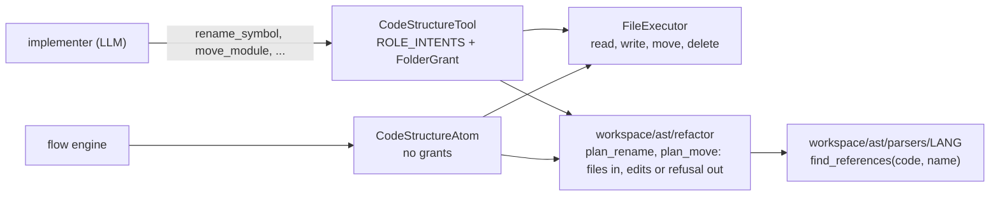

# D-SENS-06 — Structured Code Editing for Agents

**Status**: APPROVED by the user 2026-10-14 · **DAL**: D · **Story**: US-3 add-on *Structured Code Changes*
([path list](../../../stories/US-03.md), *Structured Code Changes*)

| | |
|---|---|
| Lives in | `workspace/ast/parsers/<lang>/` (find uses in one file) · `workspace/ast/refactor/` (new: plan a change across files) · `CodeStructureTool`, `CodeStructureAtom` (`sandbox/code_structure/`) |
| Used by | the implementer role, through the tool · the flow engine, through the atom. No flow step uses them yet: that is `D-INTL-09` `[agreed 2026-10-14]` |
| Plan | [SF-01](D-SENS-06_sf01_implementation_plan.md) · [SF-02](D-SENS-06_sf02_implementation_plan.md) · [SF-03](D-SENS-06_sf03_implementation_plan.md) |

## What it does

Agents have read file tools only (`E-SENS-01`). This feature gives them the rest of what a code
change needs, by name and never by raw text:

- rename a symbol, and every proven use of it in the project;
- rename or move a file, and every import of it;
- create a new file, and delete a file nobody imports;
- read and replace the comment above a symbol;
- TypeScript enums and interfaces, and Rust enums, become symbols like the others.

A change is all files or none. When the tool is not sure a name is a use of the symbol, it changes
nothing and lists the spots `[agreed 2026-10-14]`.

## Design

1. The tool or the atom reads the source files through the `FileExecutor`.
2. `workspace/ast/refactor` gets the file contents and returns either the new contents of each
   changed file, or a refusal with the unsure spots. It is pure logic: no file access.
3. The tool also checks the role's intent and the write grant of every file in the result. The
   atom does not check grants.
4. The new contents are parsed before anything is written. Then each file is written atomically.
   If one write fails, the files already written get their old contents back.

The Tool and the Atom are parallel components on the same Executor and the same refactor logic
(`docs/dev_guides/adding_tools_and_atoms.md`) `[agreed 2026-10-14]`.

### What counts as a proven use

A use is **proven** when it is one of these `[agreed 2026-10-14]`:

| Proven use | Example |
|---|---|
| the definition | `def greet(self):` |
| an import that names the symbol | `from greeter import Greeter` · `import { Greeter } from "./greeter"` · `use crate::greeter::Greeter;` |
| a bare name that resolves, in its file, to the definition or to such an import | `Greeter()` |
| a call on `self` / `this` inside the class or a subclass | `self.greet()` |
| a call on the class name | `Greeter.greet(g)` |
| a method of the override family: the same method in the classes above and below, resolved in the project | `class Loud(Greeter): def greet(self):` |

A bare name that its own file binds to something else (a local, a parameter, another definition,
an import from another module) is **unrelated** and is left alone. An attribute `x.greet` is never
unrelated just because `x` is a local: `x` may hold a `Greeter`.

Every other place in **code** where the old name appears as a name or a string is **unsure**:
`obj.greet()` with an unknown `obj`, a wildcard import of the module, a macro, `getattr(g, "greet")`,
`__all__ = ["greet"]` `[agreed 2026-10-14]`.
One unsure spot refuses the whole rename. So method renames will often refuse; that is the price
of never breaking code silently `[agreed 2026-10-14]`.

A code file that does not parse, and holds the old name, is unsure too: its uses cannot be seen.

The old name in a comment, a doc, a spec or a config file is a **text mention**. It is reported
and not changed `[agreed 2026-10-14]`.

## Research

- **Codebase.** The parsers already read, replace, add and delete one symbol, in 8 languages, with
  a parse guard (`D-SENS-02` FR-8). They do not give spans for uses: `extract_call_sites` returns
  names only and `extract_imports` returns module paths only (probe of all 8 parsers, 2026-10-14).
  The code graph has no spans either, and `sandbox` may not import `graph` (tach). So uses are
  found by new tree-sitter queries in each language's parser.
- **Gaps found by the probe.** `list_symbols` returns no TypeScript `enum`, no TypeScript
  `interface`, and no Rust `enum`.
- **Outside.** stack-graphs (GitHub) was archived 2025-09 and covered 4 languages. ast-grep and
  comby match patterns and do not resolve names. rope reports "unsure" uses for Python only.
  ts-morph is TypeScript only. None covers 8 languages, so we write our own resolver and refuse
  where it is not sure `[agreed 2026-10-14]`.

## Functional Requirements

| # | FR | Actor | Action | Outcome |
|---|-----|-------|--------|---------|
| FR-1 | Rename a symbol | CodeStructureTool, CodeStructureAtom | `rename_symbol(path, symbol_name, new_name)` | SHALL rename a symbol that `list_symbols` returns (function, method, class, enum, struct, interface, trait), its definition and every proven use in the project's files; SHALL refuse a field, constant or local; SHALL refuse a symbol with several definitions of that name in the same parent (an overload); SHALL refuse a `new_name` that is not an identifier of the language, is a keyword, is the name of another symbol in the same parent, or is already bound in a file the rename changes. The project's files are the files under the project root with the language's endings, minus the scan exclusions `[agreed 2026-10-14]` |
| FR-2 | Refuse when unsure | `workspace/ast/refactor` | finds an unsure use | SHALL change no file when any use in code is unsure, and SHALL return each unsure spot as `path:line`; the tool SHALL count, not name, a spot in a file outside the role's read grants `[agreed 2026-10-14]` |
| FR-3 | All files or none | CodeStructureTool, CodeStructureAtom | applies a change to several files | SHALL parse every new file content before the first write and refuse on a parse error; SHALL write each file atomically; SHALL restore every file already written when a later write fails, and name any file it could not restore; SHALL refuse when a file's content differs, just before its write, from what was read `[agreed 2026-10-14]` |
| FR-4 | Grants for the agent | CodeStructureTool | changes files for a role | SHALL refuse the whole change when one file in it is outside the role's write grants or is protected (`context.yaml`, `.env`, `.git`, `.specweaver`); SHALL give the number of such files and not their paths. The atom checks no grant and still refuses protected files `[agreed 2026-10-14]` |
| FR-5 | Text mentions | `workspace/ast/refactor` | finds the old name outside code | SHALL report each mention in a comment, doc, spec or config file as `path:line` and SHALL not change it; the tool SHALL count, not name, a mention outside the role's read grants `[agreed 2026-10-14]` |
| FR-6 | Seam: offered to the implementer only | ToolDispatcher | builds the code-structure tools for a role | SHALL offer every intent of this feature to the implementer role and to no other role, through `ROLE_INTENTS` and the definitions the model sees |
| FR-7 | Override family | `workspace/ast/refactor` | renames a method | SHALL rename the same method in every class above and below it that resolves in the project; SHALL refuse when a class in the family has a supertype it cannot resolve `[agreed 2026-10-14]` |
| FR-8 | Eight languages | parsers, `workspace/ast/refactor` | rename in each language | SHALL rename in Python, Java, Kotlin, TypeScript, Rust, Go, C and C++; SHALL search Java and Kotlin files together; SHALL refuse in SQL and Markdown. A C or C++ name used inside a preprocessor macro is unsure. In Go, SHALL refuse a new name that changes whether the symbol is exported `[agreed 2026-10-14]` |
| FR-9 | Enums and interfaces are symbols | TypeScript and Rust parsers | list, read and change symbols | SHALL return TypeScript `enum` and `interface` and Rust `enum` from `list_symbols`, and every symbol intent SHALL accept them `[agreed 2026-10-14]` |
| FR-10 | Rename or move a file | CodeStructureTool, CodeStructureAtom | `move_module(path, new_path)` | SHALL move the file and rewrite every import of it in the project, all or none (FR-2, FR-3); an import it cannot resolve to a file is unsure; a Rust `mod name;` line counts as an import of the file; SHALL refuse when `new_path` exists; in Java and Kotlin SHALL also rename the top-level public class named like the file, and update the `package` line when the folder changes; in Go SHALL refuse a move to another folder `[agreed 2026-10-14]` |
| FR-11 | Stay in the module | CodeStructureTool, CodeStructureAtom | moves a file | SHALL refuse a move when the nearest folder with a `context.yaml` above `new_path` is not the one above `path` `[agreed 2026-10-14]` |
| FR-12 | Create a file | CodeStructureTool, CodeStructureAtom | `create_module(path, code)` | SHALL create the file when it does not exist, its language has a parser, and `code` parses with no error; the tool SHALL also need a grant that allows creating (`FULL`) `[agreed 2026-10-14]` |
| FR-13 | Delete a file | CodeStructureTool, CodeStructureAtom | `delete_module(path)` | SHALL refuse while a file in the project imports it, or has an import it cannot resolve, and SHALL name those files; the tool SHALL also need a grant that allows deleting (`FULL`) `[agreed 2026-10-14]` |
| FR-14 | The comment above a symbol | CodeStructureTool, CodeStructureAtom | `read_symbol_doc`, `replace_symbol_doc(path, symbol_name, doc)` | SHALL read and replace a symbol's doc in the 8 code languages: the docstring in Python, the comment block directly above the symbol in the others; the doc is plain text both ways: the tool removes and adds the comment markers and the indentation; SHALL change no other line; an empty `doc` SHALL remove it `[agreed 2026-10-14]` |

## Requirement–Surface Bindings

| FR | Data needed | Provider · surface | Verified how |
|---|---|---|---|
| FR-1, FR-8 | the renamable symbols of a file | `D-SENS-02` · `CodeStructureInterface.list_symbols(code)` | ran it on all 8 parsers (2026-10-14): Python `['A','A.m','B','B.m','f']`, TypeScript no enum or interface, Rust no enum |
| FR-1, FR-2 | each use of a name, with its span | `D-SENS-02` parsers · new `find_references(code, name)` per language | read `parsers/interfaces.py`; `extract_call_sites` gives names only, `extract_imports` module paths only (same probe) |
| FR-3 | read and write file contents | `E-SENS-01` · `FileExecutor.read`, `FileExecutor.write` | read `filesystem/core/executor.py:91,161`: one write is atomic (temp file + `os.replace`); several are not, so FR-3's restore is ours |
| FR-3 | the parse guard | `D-SENS-02` · `CodeStructureAtom._breaks_parsing` | read `code_structure/core/atom.py` |
| FR-4, FR-12, FR-13 | the role's mode on a path | `E-SENS-01` · `grant_mode_for(path, grants, cwd)`, `MODE_ALLOWS_WRITE/CREATE/DELETE` | read `sandbox/security.py:31-36,189` |
| FR-4 | protected files | `E-SENS-01` · `FileExecutor._is_protected` | read `executor.py:450`; `CodeStructureAtom` builds a plain `FileExecutor` (`atom.py:57-72`), so the atom refuses them too |
| FR-6 | which intents a role gets | `D-SENS-02` · `ROLE_INTENTS` in `code_structure/interfaces/tool.py`, `ToolDispatcher._build_ast_kwargs` | read both; implementer already holds the 4 write intents |
| FR-1 | the scan exclusions | `C-SENS-02` · `ToolDispatcher` builds `exclude_dirs`, `exclude_patterns` from the parsers | read `sandbox/dispatcher.py:150-159` |
| FR-10 | move a file | `E-SENS-01` · `FileExecutor.move(src, dst)` | read `executor.py:339` |
| FR-11 | the module above a path | `E-SENS-01` · `FileExecutor.exists(path)`, walking up to the first `context.yaml` | read `executor.py:293` |

## Non-Functional Requirements

| # | NFR | Threshold / Constraint | Proof |
|---|-----|----------------------|-------|
| NFR-1 | Speed | a rename in a project of 500 Python files takes under 30 s `[agreed 2026-10-14]` | timed integration test |
| NFR-2 | Safe paths | `path` and `new_path` pass the same checks as the file tools: no `..` out of the root, no absolute path, no symlink, no `:` | hostile-input tests |
| NFR-3 | Short answers | a refusal lists at most 50 spots, then the count of the rest `[agreed 2026-10-14]` | unit test |
| NFR-4 | Same input, same result | files are planned and written in sorted path order | unit test |
| NFR-5 | No litter | a failed change leaves no temporary file | integration test |
| NFR-6 | Layers | `workspace/ast/refactor` is pure logic: consumes `workspace/ast/parsers`, forbids `sandbox` | **[proof: arch — tach/lint gate, not pytest]** |

## External dependencies

None new. `tree-sitter` and the 8 grammars are already in `pyproject.toml` (`D-SENS-02`).

## Decisions

| # | Decision | Rationale | Architectural Switch? |
|---|----------|-----------|----------------------|
| AD-1 | Own resolver on tree-sitter, per language | no outside tool covers 8 languages `[agreed 2026-10-14]` | No |
| AD-2 | New module `workspace/ast/refactor` | the parsers see one file; a rename sees many. Pure logic, beside `parsers`, inside `workspace/ast` | No |
| AD-3 | Uses found in the parser of each language | the parsers own the tree-sitter queries already | No |
| AD-4 | Tools only, no flow step | wiring is `D-INTL-09` `[agreed 2026-10-14]` | No |
| AD-5 | Not the code graph | its nodes have no spans, and `sandbox` may not import `graph` | No |

## ROI

| | |
|---|---|
| Cost | large: a use finder for 8 languages, a cross-file planner, 6 new intents |
| Return | agents can make every code change without a raw write; renames cannot break callers silently |
| Main risk | a resolver that calls a use proven when it is not. Mitigation: only the six proven kinds, everything else refuses, and a test per language for each unsure kind |

## Developer guide

`docs/dev_guides/agent_tools_reference.md` gets a code-structure section: the intents, and the
proven-use table above. Written in each sub-feature's pre-commit.

## Live demo

`ToolDispatcher.create_standard_set(..., role="implementer", allowed_tools=["ast"])` over a project
with `src/app/greeter.py` (class `Greeter`, method `greet`), two callers and a `README.md` that
names `greet`:

1. `rename_symbol Greeter.greet → welcome`: both callers change, the README line is reported.
2. Add `getattr(g, "greet")` in a caller: the rename refuses, names that line, and no file changes.
3. `move_module src/app/greeter.py → src/app/hello.py`: the callers' imports change.
4. Move it into a folder under another `context.yaml`: refused.
5. `create_module src/app/new.py`, `delete_module src/app/hello.py` (refused, names the callers),
   `replace_symbol_doc Greeter`.
6. The reviewer and the planner are offered none of these.

`tests/integration/sandbox/test_code_structure_changes_for_an_implementer.py` will do exactly this.

## Sub-features

| SF | Does | FRs | Depends on | Plan |
|----|------|-----|-----------|------|
| SF-01 | Rename a symbol in Python: planner, apply, grants, text mentions, the seam | FR-1, FR-2, FR-3, FR-4, FR-5, FR-6 | — | [sf01](D-SENS-06_sf01_implementation_plan.md) |
| SF-02 | Rename in the other 7 languages; override family; TS and Rust enums, TS interfaces | FR-7, FR-8, FR-9 | SF-01 | [sf02](D-SENS-06_sf02_implementation_plan.md) |
| SF-03 | Rename or move a file | FR-10, FR-11 | SF-02 | [sf03](D-SENS-06_sf03_implementation_plan.md) |
| SF-04 | Create and delete a file; the comment above a symbol | FR-12, FR-13, FR-14 | SF-02 | ⬜ |

SF-01 holds 6 FRs. FR-6 is small: one `ROLE_INTENTS` entry and one test, which each later
sub-feature extends with its own intents. SF-03 and SF-04 can run in parallel.

## Progress Tracker

| SF | Design | Impl Plan | Dev | Pre-Commit | Committed |
|----|--------|-----------|-----|------------|-----------|
| SF-01 | ✅ | ✅ | ✅ | ✅ | ✅ |
| SF-02 | ✅ | ✅ | ✅ | ✅ | ✅ |
| SF-03 | ✅ | ✅ | ⬜ | ⬜ | ⬜ |
| SF-04 | ✅ | ⬜ | ⬜ | ⬜ | ⬜ |

## Session Handoff

**Now**: SF-01 and SF-02 built: rename in all 8 code languages, override families, enums and interfaces as symbols.
**Next**: the dev skill for SF-03, CB-1.
