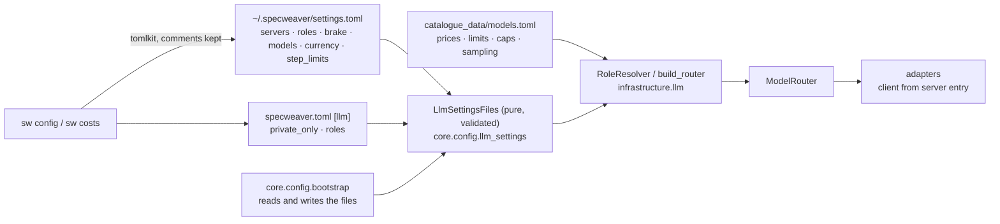

# C-FLOW-13 — Model Catalogue: One Central Place for LLM Settings

**Status**: APPROVED `[agreed 2026-09-26]`. Built; `🔜` until the user signs off. · **DAL**: C · **Story**: US-16 add-on "Centralized Model Table"
([paths](../../../stories/US-16.md)) · Decisions: [llm_settings_grilling_2026-09-26.md](../../../../analysis/llm_settings_grilling_2026-09-26.md)

| | |
|---|---|
| Absorbs | `D-FLOW-05` Model Catalogue Adoption (retired 2026-09-26) · supersedes `D-FLOW-03`, `E-FLOW-03` |
| Enables | `B-FLOW-05` brake values · `A-FLOW-01` model choice |
| Consumes | `C-FLOW-01` telemetry · `E-FLOW-01` config DB (its LLM tables are removed) |
| Not touched | brake behaviour (`B-FLOW-05`) · measuring and choosing models (`A-FLOW-01`) · API keys' storage (env vars stay) |

## What it does

Every LLM call gets its model, server, sampling and price from one place: the machine file
`~/.specweaver/settings.toml`, a project's `[llm]` section in `specweaver.toml`, and a short shipped
model list. `sw` commands write the same files. Nothing else holds an LLM setting, and nothing is
built into the code: a model command refuses until the user names a model and the run's limits.

## Architecture

| Piece | Lives in | Why there |
|---|---|---|
| `LlmSettingsFiles` models and validation (servers, roles, brake, currency, model facts) | `core.config.llm_settings` | pure, importable by llm, flow, cli |
| File reading and writing | `core.config.bootstrap` | the one module allowed file I/O for settings |
| Model list and resolver | `infrastructure.llm` | read by adapters and telemetry without importing bootstrap |
| Client construction from a server entry | `infrastructure.llm.servers` | one place builds every client |

Layering, lowest to highest: model list → machine file → project `[llm]` → `--model` for one run.
The project level may set only `private_only` and `[llm.roles]` `[agreed 2026-09-26]`: a cloned repo
must not be able to send code to its own server.

## Decisions

| # | Decision | Why |
|---|---|---|
| AD-1 | Files, not the DB, hold settings; the DB keeps only records (usage, spend) `[agreed 2026-09-26]` | readable in one look, reviewable, versioned with the project |
| AD-2 | Roles are written `model@server` in `[roles]` `[agreed 2026-09-26]` | one line says what runs where |
| AD-3 | Privacy is a property of the **server**, not the model | the same Qwen is private on the GB10 and public on a cloud host |
| AD-4 | Every client gets its address explicitly from its server entry, or its adapter's own default; `OPENAI_BASE_URL` is ignored | one stray env var would send private code to the cloud or cloud calls to the GB10 |
| AD-5 | Read with `tomllib`, write with `tomlkit` | tomlkit keeps the user's comments; tomllib is stdlib |
| AD-6 | Each file is validated alone, strictly (`extra="forbid"`), before layering | every error can name its own file; a typo cannot pass as a default |
| AD-7 | Model list: short, kept by hand, prices from models.dev (MIT, credited), never fetched at runtime `[agreed 2026-10-09]` | a price change is a reviewed one-line edit |
| AD-8 | Prices stored in USD per 1M tokens; converted only at display, to the one configured currency, with the dated manual rate `[agreed 2026-09-26]`; the currency is configurable `[agreed 2026-09-27]` | the providers' unit; history does not shift when the rate changes |
| AD-9 | No migration from the database `[agreed 2026-09-27]` | the old DB held nothing worth moving |

## Functional Requirements

FR-14 (migration) was dropped `[agreed 2026-09-27]`.

| # | FR | Actor | Action | Outcome |
|---|-----|-------|--------|---------|
| FR-1 | Machine settings | Loader | SHALL read `specweaver_root()/settings.toml`; a missing file is an empty one: commands that call no model work, a model command refuses naming `roles.default` or the unset `brake.*` key | nothing runs on a model or a limit the user never chose; `SPECWEAVER_DATA_DIR` moves the file with the data |
| FR-2 | Project settings | Loader | SHALL read the `[llm]` section of the project's `specweaver.toml`, accepting only `private_only` and `[llm.roles]` | a project chooses; it cannot define servers or keys |
| FR-3 | One resolved setting | Resolver | SHALL resolve each call's model, server and sampling as model list → machine → project → `--model`; a role may be a string `"model@server"` or a table adding sampling overrides; `sw config show` SHALL print every value with its origin | one answer per call, and the user can see where it came from |
| FR-4 | Broken file refuses | Loader | SHALL refuse any command that resolves LLM settings on invalid TOML, an unknown key or a wrong type, naming the file, the key and the line; commands that call no LLM (e.g. `sw check`) are unaffected | a typo never becomes a silent default |
| FR-5 | Project cannot redirect | Loader | SHALL refuse a project file that sets a server, a `base_url` or an `api_key_env` | a cloned repo cannot send code elsewhere |
| FR-6 | Model facts | Resolver | SHALL read per-model facts — price per 1M input/output tokens (USD), context size, max output, tool calling, whether output can be capped including thinking, sampling defaults — from the shipped list, overridable by `[models."<id>"]` in the machine file (`"<kind>/<id>"` for one kind only) | a new model is a data change, not a release |
| FR-7 | Servers | Adapters | SHALL build each client from its server entry — `base_url`, `api_key_env`, `max_parallel` — and a server without a key SHALL be usable; a provider's own key is sent only to that provider's address | the GB10 can be configured; keyless local servers work |
| FR-8 | Parallel limit per address | Adapter path | SHALL limit concurrent requests per server **address** to its `max_parallel`; two entries at one address share it | the GB10 and a cloud provider do not share one semaphore |
| FR-9 | Privacy rule | Resolver | SHALL refuse, before any call, a role that points at a server with `private = false` when the project sets `private_only = true`, naming the rule and the role | no silent fallback to the cloud |
| FR-10 | One adapter path | `build_router`, `RoleResolver` | SHALL obtain every adapter through the same resolver and wrapper — CLI, REST and pipeline runs alike | every call passes the brake, the limit and the usage flush |
| FR-11 | No hard-coded models | Handlers, workflows | SHALL take the model from the resolver — the step's role, else `[roles] default`; with neither set the command SHALL refuse, naming the role and `sw config set-role` `[agreed 2026-09-26]`. One exception: `sw standards scan` runs without a model when none is set, and says so `[agreed 2026-10-08]` | no step silently asks for a model the user never chose |
| FR-12 | One price source | Telemetry, `sw costs` | SHALL price every call from the model list plus machine overrides; an unknown price SHALL be reported as unknown, not as 0 | the recorded number is right, or visibly unknown |
| FR-13 | One currency | `sw costs`, `sw usage`, brake values | SHALL show and take every amount in the one currency `[currency] code` sets, at `per_usd` with `rate_date`; without `[currency]` it SHALL use USD `[agreed 2026-09-27]` | one currency everywhere, and the rate's age is known |
| FR-15 | Commands write the files | `sw config set-role`, `sw costs set`, `sw costs reset` | SHALL write the machine or project file with `tomlkit`, keeping comments, line endings and file mode | the commands and the file are one truth |
| FR-16 | Model for one run | `sw implement`, `sw run`, `sw resume` | SHALL accept `--model <model@server>` for this run only | a quick trial needs no file edit |
| FR-17 | Brake values handed over | Resolver → brake | SHALL provide the `[brake]` values (`hosted_spend_per_run`, `tokens_per_run`, `agent_turns`) to the brake — **seam with `B-FLOW-05`** | the values live here; the behaviour lives there |
| FR-18 | Model list upkeep | `catalogue_data/models.toml` | SHALL ship a short list kept by hand: every hosted model on it has both prices, at the highest tier, and an output limit, and the list states the date its prices were checked `[agreed 2026-10-09]` | a price change is a one-line, reviewable edit, never a runtime fetch |

## Non-Functional Requirements

| # | NFR | Threshold / Constraint |
|---|-----|----------------------|
| NFR-1 | Load cost | Settings resolved once per command, under 50 ms for files under 20 KB `[agreed 2026-09-26]` |
| NFR-2 | No secrets written | No API key value appears in any settings file, log line or error message |
| NFR-3 | Offline | No network access to read settings or the model list |
| NFR-4 | One reader | Only `core.config.bootstrap` reads or writes the settings files; `tach` limits the imports |
| NFR-5 | Versioned files | Both files and the model list carry `schema_version`; an unknown version refuses with an upgrade message |
| NFR-6 | Comments survive | A `sw` write leaves every existing comment and key order in the file unchanged |

## Live demo

With a `[servers.gemini]` server, `default = "gemini-3.8-flash@gemini"` and `GEMINI_API_KEY` set:

- `sw config show` → every value with the file and line it came from; the key variable, never the key.
- `sw review <spec>` → a real review; with `[llm] private_only = true` in the project → refused
  before any call, naming the role and its line.
- `sw costs` → the model's price and this month's spend, in the `[currency]` set.

The nightly live run (`B-FLOW-05` NFR-4) makes its calls through these settings.

## Where it plugs in

| FR | Data needed | Provider · surface |
|---|---|---|
| FR-1 | data dir | `paths.specweaver_root()` |
| FR-2 | project root | `_core.project_root()` |
| FR-10 | every adapter | `build_router(files, *, project, roles, run_model, ask, db)` → `RoleResolver` → `adapter_for_server` |
| FR-7 | client construction | adapters take `api_key` and `base_url` (`adapters/base.py`) |
| FR-8 | the limiter | `AsyncRateLimiterAdapter(adapter, limit=server.max_parallel, key=name, address=…)` (`servers.py`) |
| FR-12 | pricing | `estimate_cost(usage, facts) -> float \| None` (`telemetry.py`) |
| FR-15 | the writer | `bootstrap/llm_settings_writer.py` |
| FR-17 | brake input | `brake_limits(files)`; `SpendBudget(currency, ask)`, `before_call(scope, worst)` |

## Risks

| Risk | Mitigation |
|---|---|
| One file's list could wipe another's in a merge | one source per file, explicit layering (AD-6) |
| TOML errors carry no line number on Python 3.11–3.13 | the line is found by scanning the text (`toml_lines.py`) |
| A stale env var overrides the file invisibly | `sw config show` prints each value's origin (FR-3) |
| Prices go stale | `sw costs` shows the date the list was checked; the list is edited by hand |
| Qwen tool calling on vLLM | parser `qwen3_xml`, not `qwen3_coder` (loops on long tool inputs); noted in the model list |

## Sub-features

| SF | Does | FRs | Plan | Committed |
|----|------|-----|------|-----------|
| SF-01 | Settings models, loader, validation, layering, `sw config show` | FR-1, FR-2, FR-3, FR-4, FR-5 | [sf01](C-FLOW-13_sf01_implementation_plan.md) | ✅ |
| SF-02 | Model list, server entries, adapters built from servers, per-address limit, privacy rule | FR-6, FR-7, FR-8, FR-9, FR-18 | [sf02](C-FLOW-13_sf02_implementation_plan.md) | ✅ |
| SF-03 | One adapter path, no hard-coded models, one price source, one currency, commands write the files | FR-10, FR-11, FR-12, FR-13, FR-15 | [sf03](C-FLOW-13_sf03_implementation_plan.md) | ✅ |
| SF-04 | Retired `[agreed 2026-09-27]`: no migration (FR-14 dropped); FR-15 moved to SF-03 | — | — | — |
| SF-05 | `--model` for one run; brake values handed to `B-FLOW-05` | FR-16, FR-17 | [sf05](C-FLOW-13_sf05_implementation_plan.md) | ✅ |
